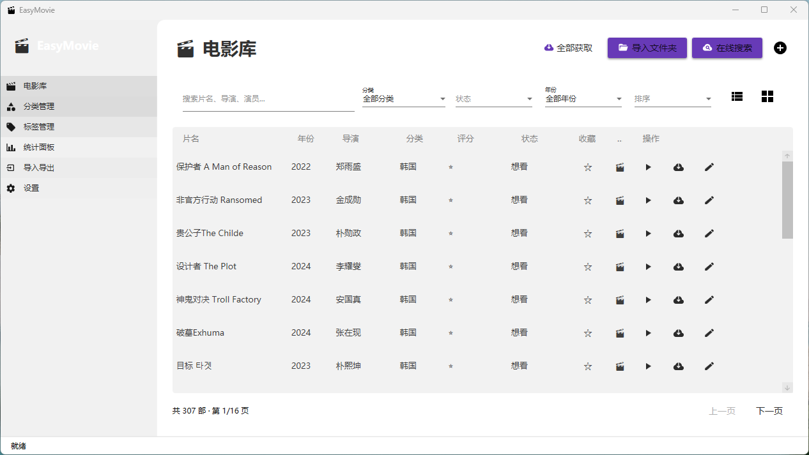

# 🎬 EasyMovie — Manage Your Movie Collection with Ease

A Windows desktop movie collection manager built with WPF + Material Design + SQLite and a VLC playback core. Simple and intuitive.

English | [简体中文](README.zh-CN.md)


## 📥 Download

> Don't want to compile? Grab the portable version, unzip and run!

| Platform | Download |
|----------|----------|
| Windows x64 | [](https://github.com/cqdoctor/EasyMovie/releases/latest) |

Go to [Releases](https://github.com/cqdoctor/EasyMovie/releases) and download `EasyMovie-win-x64.zip`, then run `EasyMovie.Client.exe`.

## 🎥 Demo

- 📺 [B站 Demo](https://space.bilibili.com/) — 2-minute feature overview
- 📺 [YouTube Demo](https://youtube.com/) — Feature walkthrough

## 📸 Screenshots

<p align="center">
  
</p>

## ✨ Features

### 🏠 Dashboard
- **Dashboard** — Startup homepage, shows recent additions / recent watches / favorites / popular directors
- **Quick Navigation** — Click cards to jump to movie details or play

### 🎬 Movie Library
- **Multi-View** — Table / Card / Poster Wall / Collections, four view modes
- **Quick Filters** — One-click tabs for All / Favorites / Watchlist at the top
- **Search & Filter** — Full-text search + Advanced filter (Category/Year/Rating/Status/Favorite/Tags AND/OR)
- **Reusable Filter Presets** — Save/load filter combinations; legacy presets are normalized on load (strips the "All" sentinel, normalizes empty values)
- **Pinyin Search** — Quick search by Chinese pinyin full spelling or initials
- **Batch Edit** — Multi-select + batch modify category/status/rating/favorite
- **Sort & Paginate** — Multi-field sorting + paginated browsing (First/Last page + jump)
- **Missing File Alert** — Play button disabled with tooltip when local file is missing
- **One-Click Favorite** — Toggle ★/☆ directly in the list
- **Instant First Page** — First page loads immediately, filter data initializes in background

### 🎥 Player
- **Embedded Playback** — LibVLCSharp-based player embedded in the main window (no separate popup window)
- **Hardware Decoding** — d3d11va hardware decoding by default (avoids the dxva2 white-screen issue), software decoding fallback available
- **Subtitles & Audio Tracks** — Switch between multiple subtitle/audio tracks, read from media track info (not affected by playback state)
- **Playback Speed** — Multiple speed presets
- **Fullscreen / Mini Mode** — Fullscreen and mini-window playback; exiting fullscreen restores the main window chrome
- **Volume & Snapshot** — Volume control and in-playback snapshots

### 📁 Categories & Tags
- **Categories** — Multi-level category tree, unlimited nesting, auto-categorize by country
- **Tags** — Custom color tags with many-to-many association
- **Unified Page** — Categories and tags managed together in one page
- **Auto-Categorize** — Auto-assign category based on country when fetching info

### 🎞️ Movie Collections
- **Collection Management** — Create/Edit/Delete collections, e.g. "Marvel Universe", "Harry Potter Series"
- **Poster Display** — Movies in collection shown as poster wall with play & detail buttons
- **Flexible Management** — Add/Remove movies, search with pinyin support

### ⭐ Ratings & Records
- **Rating System** — 1-10 rating + watch status (Not Watched / Want to Watch / Watched) + notes + favorites
- **Status Toggle** — Click status text in list to cycle: Not Watched → Want to Watch → Watched
- **Play to Mark** — Click play button auto-marks as "Watched" and creates watch log
- **Watch Logs** — Create/edit watch records from the movie detail page
- **Duplicate Detection** — Auto-detect duplicate movies, one-click cleanup

### 📅 Watch Calendar
- **Calendar View** — Browse watch records by month, intuitive daily overview
- **Auto Logging** — Watch logs created automatically when playing or marking as watched
- **Month Navigation** — Navigate between months, today highlighted
- **Movie Details** — Calendar cells show movie titles, hover for ratings

### 📊 Statistics
- **Overview Cards** — Total/Watched/WantToWatch/NotWatched/Rating/Favorites/Total Runtime
- **Rating Distribution** — Horizontal bar chart, 10 to 1
- **External Rating Backfill** — When a personal rating is missing, locally cached external ratings (Douban/TMDB etc.) are used; fully local, zero network
- **Yearly Trend** — Dual-color bar chart (Total + Watched), descending order
- **Monthly Watch** — Watch count per month this year
- **Director/Cast Ranking** — Top 10 by appearance count
- **Country Distribution** — Movie origin distribution
- **Runtime Distribution** — Short/Standard/Long film range distribution

### 🔗 Movie Relations
- **Relation Graph** — Visualize director-actor collaboration relationships
- **Node Interaction** — Click person nodes to highlight connections, view collaboration movie list
- **Path Finding** — Find the shortest collaboration path between any two people

### 📰 Movie News
- **Trending** — Integrated with Maoyan/TMDB for trending movie news
- **One-Click Add** — Click news cards to fetch movie details and add to library

### 🤖 AI Recommendations
- **Multi-Turn Chat** — Personalized recommendations based on your library profile (genres, directors, tags, etc.)
- **Multi-Provider** — Built-in presets for DeepSeek / Zhipu GLM / Qwen / Baidu ERNIE / Moonshot / Doubao / Ollama
- **Flexible Config** — Set API Key / Endpoint / model name in Settings, with one-click connection test
- **Streaming Response** — AI replies stream in token by token, simulating typing

### 🔥 Watch Heatmap
- **GitHub Style** — 53 weeks × 7 days green cell matrix, auto-adapts to light/dark theme
- **Hover Details** — Hover to show date + movies watched that day
- **Stats Cards** — Total watches / watch days / max per day / longest streak
- **Top Days** — Top 10 most active watch dates with movie lists

### 📦 Data Management
- **Multi-Format Import/Export** — CSV/JSON import/export + full backup & restore (from Settings)
- **Folder Import** — Auto-scan local movie files and match info
- **Auto Backup** — Configurable daily/weekly/monthly automatic database backup
- **Backup History** — View backup list, one-click restore or delete
- **Manual Backup** — Create backup anytime, open backup folder

### 🌐 Multi-Source Search
- **Concurrent Sources** — Douban / TMDB / OMDb / 1905 / Maoyan fetched concurrently; TMDB/1905/OMDb as the main chain with Douban as fallback
- **Offline Cache First** — Local `cache.db` hit takes priority, reducing network dependency and rate-limit impact
- **Cover Download** — Auto-download HD posters
- **Info Completion** — Title/Director/Actors/Year/Country/Synopsis auto-fill
- **Smart Search** — Auto-clean encoding tags from filenames, multi-keyword multi-source search
- **Data Cleaning** — Cleaned at a single fetch entry point: strips JS template variables, invalid name labels and HTML

### ⌨️ Keyboard Shortcuts
- **Configurable** — Customize shortcuts in Settings, click-to-record, conflict detection
- **Persistent** — Custom shortcuts saved locally, survive restarts
- **Defaults** — Ctrl+F Search / Ctrl+N Add / Delete Remove / F5 Refresh / F3 Cycle View, etc.

### 🎨 UI & Experience
- **Theme** — Light/Dark/Follow system
- **i18n** — Chinese/English interface switching
- **Collapsible Navigation** — Statistics and Discover groups, accordion-style, collapsed by default
- **Custom Dialogs** — Material Design styled dialogs replacing system MessageBox
- **Friendly Errors** — Exceptions are categorized into localized messages, pointing to `logs/crash.log` for details
- **Performance** — Page pre-loading + batch DB operations + background poster decoding/disk cache, keeping large BLOBs out of memory

## 🛠️ Tech Stack

| Layer | Technology |
|---|---|
| UI | WPF + MaterialDesignInXamlToolkit 5.x |
| MVVM | CommunityToolkit.Mvvm |
| Playback | LibVLCSharp.WPF 3.9.3 (VLC core) |
| Database | SQLite + EF Core 9 |
| CSV | CsvHelper |
| Logging | Serilog |
| Testing | xUnit + Moq + FluentAssertions (485+ cases) |

## 📁 Project Structure

```
EasyMovie/
├── EasyMovie.Client/     # WPF desktop client
│   ├── Views/            # Views (Library/Detail/Player/Categories/Stats/Calendar/Relations/News/AI/Heatmap/Settings)
│   ├── ViewModels/       # View models (CommunityToolkit.Mvvm)
│   ├── Strings/          # i18n resources (zh-CN/en-US)
│   ├── Converters/       # Value converters
│   └── App.xaml          # Theme & global config & DI container
├── EasyMovie.Core/       # Core business layer (pure logic, no WPF dependency, unit-testable)
│   ├── Models/           # Movie, Category, Tag, SavedFilter, MovieFilterValues/State ...
│   ├── Helpers/          # MovieQueryBuilder / TextCleaner / MovieCreditCleaner / SavedFilterMapper
│   ├── Interfaces/       # Service interfaces
│   └── Services/         # Business logic
├── EasyMovie.Data/       # Data access layer
│   ├── Repositories/     # Repository implementations
│   ├── StatisticsService # Statistics aggregation
│   ├── RatingBackfill    # External rating backfill (local cache.db)
│   ├── MovieBootstrapService / AiLibrarySummaryService
│   └── CollectionService / WatchLogService / TextCleanupMigration
├── EasyMovie.Tools/      # Tools & APIs
│   ├── ImportExport/     # Import/export services
│   ├── MovieApi/         # Douban/TMDB/OMDb/1905/Maoyan clients + local cache
│   └── AIChat/           # LLM integration (DeepSeek/GLM/Qwen/ERNIE/Moonshot/Doubao/Ollama)
├── EasyMovie.Tests/      # Unit tests (xUnit, 485+ cases)
└── MovieListHeadlessTest/# Headless smoke host: instantiates MovieListView for load/page/switch regression
```

## 🚀 Build & Run

```bash
# Restore dependencies
dotnet restore EasyMovie.sln

# Build (recommended to disable parallel build to avoid csc crash)
dotnet build EasyMovie.Client/EasyMovie.Client.csproj -p:BuildInParallel=false

# Run
dotnet run --project EasyMovie.Client/EasyMovie.Client.csproj

# Run tests
dotnet test EasyMovie.Tests/EasyMovie.Tests.csproj
```

### Requirements

- .NET 10 SDK
- Windows 10/11

## 📋 Development Progress

| Phase | Content | Status |
|---|---|---|
| 1 | Project skeleton + Data layer | ✅ |
| 2 | Movie library UI + Search & filter | ✅ |
| 3 | Categories/Tags + Rating & favorites | ✅ |
| 4 | Statistics panel with multiple charts | ✅ |
| 5 | Import/Export + Backup & restore | ✅ |
| 6 | Multi-source API integration | ✅ |
| 7 | Theme/Settings/Logging/Packaging | ✅ |
| 8 | Project rename to EasyMovie | ✅ |
| 9 | i18n (Chinese/English) | ✅ |
| 10 | Advanced filter + Save filter presets | ✅ |
| 11 | Batch edit + Duplicate detection | ✅ |
| 12 | Configurable keyboard shortcuts | ✅ |
| 13 | Movie collection management | ✅ |
| 14 | Watch calendar + Quick filters + Simplified watch status | ✅ |
| 15 | Dashboard + Movie news + Movie relation graph | ✅ |
| 16 | Pagination enhancement (First/Last page) + Instant first page | ✅ |
| 17 | Watch heatmap + AI recommendations (multi-provider LLMs) | ✅ |
| 18 | External rating backfill in statistics (local cache, zero network) | ✅ |
| 19 | MovieListView logic moved to Core + headless regression host | ✅ |
| 20 | Unified player (removed redundant fallback window) + single-source filters + dead code cleanup | ✅ |

## 📄 License

MIT License

> 💡 If you find this project useful, please give it a Star ⭐!
